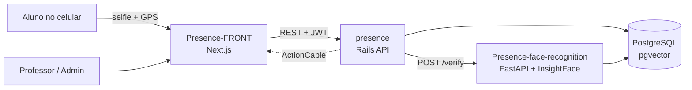

<h1 align="center">Presence · API</h1>

<p align="center">
  Controle de presença universitária com <b>geolocalização</b> e <b>reconhecimento facial</b>.
</p>

<p align="center">
  
  
  
  
  
</p>

---

## Sobre

O **Presence** substitui a lista de chamada em papel. O professor cria um evento (aula, palestra, prova)
para turmas e cursos; o aluno abre o link do evento no celular e confirma a presença. A confirmação só é
aceita quando três condições batem:

1. **Janela de horário** – o evento está acontecendo.
2. **Localização** – o aluno está perto do local do evento (distância calculada a partir da geolocalização do navegador).
3. **Rosto** – a selfie do aluno corresponde aos embeddings faciais cadastrados dele.

Este repositório é a **API central** do sistema. Ele faz parte de um conjunto de três serviços:

| Repositório | Papel |
|---|---|
| **presence** (este) | API Rails: autenticação, cadastro, eventos, regras de presença, exportação |
| [Presence-FRONT](https://github.com/CarHSMig/Presence-FRONT) | Painel administrativo e página pública de confirmação (Next.js) |
| [Presence-face-recognition](https://github.com/CarHSMig/Presence-face-recognition) | Microserviço de embeddings e verificação facial (FastAPI + InsightFace) |



## Funcionalidades

- **Autenticação JWT** com Devise + devise-jwt e autorização por política com Pundit.
- **Cadastro acadêmico:** cursos, turmas (criação em lote) e alunos.
- **Importação de alunos** por planilha CSV/XLSX, com modelo para download.
- **Biometria:** cadastro e remoção de embeddings faciais por aluno, delegados ao microserviço Python.
- **Eventos** vinculados a cursos e turmas, com local e janela de horário.
- **Confirmação de presença** pública por evento, validando horário, distância e rosto.
- **Exportação** da lista de participantes em CSV e XLSX.
- **Tempo real** via ActionCable (`PresenceChannel`).
- Envio de e-mails transacionais via SMTP (Brevo).

## Endpoints principais

| Método | Rota | Descrição |
|---|---|---|
| `POST` | `/users/sign_in` | Login (retorna JWT) |
| `GET` | `/users/current_user` | Usuário autenticado |
| `CRUD` | `/admin/courses` | Cursos |
| `CRUD` | `/admin/courses/:id/class_rooms` · `POST …/batch` | Turmas |
| `CRUD` | `/admin/courses/:id/class_rooms/:id/students` | Alunos |
| `POST` | `…/students/import` · `GET …/students/template` | Importação por planilha |
| `POST/DELETE` | `…/students/:id/add_embedding` · `delete_embedding` | Biometria facial |
| `CRUD` | `/admin/events` · `GET classrooms_by_courses` | Eventos |
| `GET` | `/admin/events/:id/participants/export_participants` | Exportação CSV/XLSX |
| `GET` | `/participants/:event_id` | Dados públicos do evento |
| `PATCH` | `/participants/:event_id/confirm_presence` | Confirmação de presença |
| `WS` | `/cable` | ActionCable |

A coleção completa do Postman está em [`docs/`](docs/).

## Stack

- **Ruby 3.3.4 / Rails 8 (API mode)**
- **PostgreSQL** com `pgcrypto` (UUIDs) e `pgvector`
- **Devise + devise-jwt**, **Pundit**, **jsonapi-rails**, **Ransack**, **Kaminari**
- **Redis + ActionCable**
- **roo / caxlsx** para planilhas, **HTTParty / Faraday** para integrações
- **RSpec + FactoryBot** (models, policies, requests e routing)
- **Docker**

## Como rodar

Pré-requisitos: Ruby 3.3.4, PostgreSQL com a extensão `pgvector` e Redis.

```bash
git clone https://github.com/CarHSMig/presence.git
cd presence
bundle install
bin/rails db:create db:migrate db:seed
bin/rails s
```

Variáveis de ambiente:

| Variável | Uso |
|---|---|
| `DATABASE_URL` | Conexão com o PostgreSQL |
| `REDIS_URL` | ActionCable |
| `FACE_AUTH_API_URL` | URL do [Presence-face-recognition](https://github.com/CarHSMig/Presence-face-recognition) |
| `FRONTEND_URL` | Origem liberada no CORS e links de e-mail |
| `DEFAULT_URL_HOST` | Host usado nas URLs geradas |
| `DEVISE_JWT_SECRET_KEY` | Assinatura dos tokens JWT |
| `RAILS_MASTER_KEY` | Credenciais (SMTP) |

### Testes

```bash
bundle exec rspec
```

## Autor

**Carlos Henrique dos Santos Migon** · [LinkedIn](https://www.linkedin.com/in/carlos-henrique-dos-santos-migon-46387b336/) · [GitHub](https://github.com/CarHSMig)
